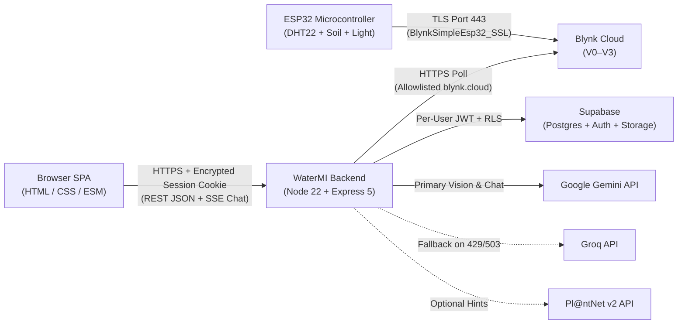

# WaterMI

**AI-powered plant & crop health monitoring with live ESP32 environmental sensors.**

[](https://github.com/pobtumtangs-crypto/WaterMi/actions/workflows/ci.yml)


**Live App:** [watermi.onrender.com](https://watermi.onrender.com)

WaterMI helps farmers and growers monitor crop health from one mobile-first web app. Take a photo for an instant AI health check, ask follow-up questions in a grounded crop-care chat, track watering schedules and health trends over time, and connect ESP32 hardware sensors for real-time environmental telemetry.

---

## Features

- **Dashboard:** Track all saved plants, watering countdowns, overdue alerts, health score trends, and live sensor readings in each plant's detail view.
- **Deep Analysis:** Upload or capture a plant photo for a structured AI diagnosis (0–100 health score, visible problems by severity, prioritized actions, prevention tips, watering advice, and optional Pl@ntNet species/disease hints).
- **AI Crop Advisor Chat:** Real-time streaming (SSE) plant advisor grounded in the selected plant's record, latest checkup photo, and connected sensor values.
- **ESP32 Live Sensors:** In-app wiring diagram, custom firmware generator (`watermi_blynk.ino`), per-plant Blynk token linking, and live status polling for temperature, humidity, soil moisture, and ambient light.
- **Multi-User Accounts & Security:** Supabase Auth with Row-Level Security (RLS), encrypted `HttpOnly` sessions, persistent logout revocation, encrypted IoT token storage, rate limiting, CSRF protection, and strict Content-Security-Policy headers.

---

## Architecture



---

## Tech Stack

| Layer | Technology |
|---|---|
| **Frontend** | Vanilla HTML5, CSS3, ES Modules (zero build step, zero external CDN dependencies, strict CSP compatible) |
| **Backend** | Node.js `>=22.9` (ESM), Express `5`, native `node:crypto` (AES-256-GCM, async `scrypt`) |
| **Database, Auth & Storage** | Supabase PostgreSQL with Row-Level Security (RLS), Supabase Auth, private `plant-photos` Storage bucket |
| **AI & Recognition** | Google Gemini API (`gemini-3.8-flash`, `gemini-3.5-flash-lite`, `gemini-3.1-flash-lite`), Groq fallback (`qwen/qwen3.8-27b`), Pl@ntNet v2 |
| **IoT Hardware** | ESP32 (Arduino C++), DHT22, capacitive soil moisture sensor, analog light sensor, Blynk Cloud over TLS |
| **Deployment & Testing** | Non-root Docker (`node:22.14.0-slim`), Render Blueprint (`render.yaml`), Fly.io & Railway configs, Node `node --test` (90 tests) |

---

## Quick Start

### 1. Run Locally in Demo Mode (No API Keys Needed)
```bash
npm ci
npm run demo
```
Open [http://localhost:3000](http://localhost:3000) — uses mocked AI replies and local demo accounts.

### 2. Run Locally with Real AI & Supabase
1. Install **Node.js 22.9 or newer**.
2. Copy `.env.example` to `.env`:
   ```bash
   cp .env.example .env
   ```
3. Fill in `GEMINI_API_KEY` (from [Google AI Studio](https://aistudio.google.com/apikey)), `SUPABASE_URL`, `SUPABASE_ANON_KEY`, and a 32+ char `SESSION_SECRET`.
4. Apply the SQL migrations in [`supabase/migrations/`](supabase/migrations/) to your Supabase project (see [DEPLOY.md](DEPLOY.md)).
5. Start the server:
   ```bash
   npm ci
   npm start
   ```

### 3. Run the Test Suite
```bash
npm test
```
Runs 90 automated unit, integration, UI DOM, and security regression tests offline with mocked upstreams.

---

## Environment Variables & API Keys

Never commit `.env` (it is ignored by `.gitignore`). In production, configure these in your hosting dashboard (e.g., Render Environment Variables).

| Variable | Required in Prod | Purpose |
|---|---|---|
| `SUPABASE_URL` | Yes | Supabase project URL (`https://<ref>.supabase.co`) |
| `SUPABASE_ANON_KEY` | Yes | Supabase public anon key (used with each user's JWT under RLS) |
| `SESSION_SECRET` | Yes (≥ 32 chars) | Encrypts `__Host-watermi.sid` `HttpOnly` session cookies |
| `DATA_ENCRYPTION_KEY` | Recommended | Dedicated AES-256-GCM key for encrypting stored per-plant Blynk tokens |
| `PUBLIC_ORIGIN` | Yes* | Canonical HTTPS origin for CSRF checks & email callbacks (*Render sets `RENDER_EXTERNAL_URL` automatically*) |
| `GEMINI_API_KEY` | Yes | Primary AI photo analysis and streaming plant-care chat |
| `GROQ_API_KEY` | Optional | Last-resort analysis fallback when all Gemini models return `429`/`503` |
| `PLANTNET_API_KEY` | Optional | Botanical species & disease suggestions (JPEG/PNG) |
| `SENSOR_KEY` | Optional | Shared secret checked in `x-sensor-key` header on sensor push/webhook routes |
| `BLYNK_TEMPLATE_ID` | Optional | Pre-fills the default Blynk Template ID on the Sensors setup tab |

---

## ESP32 & Blynk Sensor Setup

WaterMI includes an in-app sketch generator on the **Sensors** tab that customizes [`arduino/watermi_blynk/watermi_blynk.ino`](arduino/watermi_blynk/watermi_blynk.ino) for your Wi-Fi, Blynk credentials, and GPIO pins.

| Sensor | Default ESP32 Pin | Blynk Virtual Pin | Validated Range |
|---|---|---|---|
| **DHT22 (Temperature)** | `GPIO 4` | `V0` | `-40` to `80 °C` |
| **DHT22 (Humidity)** | `GPIO 4` | `V1` | `0` to `100 %` |
| **Ambient Light (optional)** | `GPIO 35` (ADC1) | `V2` | `0` to `4095` (raw ADC) |
| **Capacitive Soil Moisture** | `GPIO 34` (ADC1) | `V3` | `0` to `100 %` (8-sample avg) |

- Connects to Blynk Cloud over **encrypted TLS** (`BlynkSimpleEsp32_SSL.h`, port 443).
- Includes a **30-second hardware watchdog** (`esp_task_wdt.h`) and non-blocking exponential Wi-Fi/Blynk reconnect backoff.
- Full wiring and calibration steps are documented in [`arduino/README.md`](arduino/README.md).

---

## API Overview

| Endpoint | Auth | Description |
|---|---|---|
| `GET /healthz` | Public | Container & platform health check |
| `GET /api/config` | Optional | Client auth state and active AI/sensor configuration |
| `POST /api/auth/register`, `/login`, `/callback`, `/logout` | Public / Cookie | Email/password auth, email confirmation, and persistent logout revocation |
| `GET /api/plants`, `POST /api/plants` | User | List owned plants (with live Blynk sync) or create a plant |
| `PATCH /api/plants/:id`, `DELETE /api/plants/:id` | User | Update plant details, mark watered, link/unlink Blynk token, or delete plant |
| `POST /api/plants/:id/checkups`, `DELETE .../checkups/:cid` | User | Save or delete photo checkups in Supabase Storage + Postgres |
| `GET /photos/:owner/:photo` | User (owner) | Authenticated photo proxy with `default-src 'none'; sandbox` CSP |
| `POST /api/analyze` | User | Structured JSON plant health report with multi-model fallback |
| `POST /api/chat` | User | Server-Sent Events (SSE) streaming crop-care chat |
| `POST /api/plants/:id/sensors`, `POST /api/webhook/blynk` | User (+ `x-sensor-key`) | Sensor telemetry ingestion |

Error responses use consistent `{ "error": "...", "code": "..." }` JSON payloads (`authentication_required`, `invalid_origin`, `rate_limited`, `bad_request`, `not_found`, `too_large`, `quota`, `busy`, `no_key`, `bad_key`, `bad_model`, `ai_error`, `server_error`).

---

## Security & Responsible AI

- **Defense-in-Depth:** See [`SECURITY.md`](SECURITY.md) for details on authentication, RLS policies, SSRF allowlisting, AES-256-GCM token encryption, strict CSP, and vulnerability reporting.
- **Responsible AI Use:** Photo analysis and chat replies are visual suggestions, not confirmed agronomic diagnoses. Always verify plant conditions before applying fertilizers, pesticides, or fungicides, and follow product labels and local regulations.
- **Third-Party Data:** Uploaded photos and plant notes are sent to Google Gemini (and optionally Pl@ntNet / Groq fallback when enabled).

---

## Project Structure

```text
.
├── server.js                 # Express 5 API, auth/sessions, Blynk sync & AI orchestrator
├── supabase.js               # Per-request Supabase client factory
├── groq.js                   # Groq fallback analysis client
├── plantnet.js               # Pl@ntNet v2 species & disease hints client
├── public/                   # Mobile-first frontend SPA & auth pages
├── arduino/
│   ├── watermi_blynk/        # Hardened TLS ESP32 + Blynk firmware
│   └── README.md             # Hardware wiring, calibration & troubleshooting
├── supabase/migrations/      # Versioned Postgres schema, RLS & storage migrations
├── test/api.test.js          # 90 automated backend, UI & security tests
├── Dockerfile                # Non-root production container
├── render.yaml               # Render Docker Blueprint
├── fly.toml / railway.toml   # Alternative cloud deployment configs
├── DEPLOY.md                 # Full deployment & operations guide
└── SECURITY.md               # Security architecture & reporting policy
```

For production deployment, database migrations, backups, and secret rotation procedures, see [`DEPLOY.md`](DEPLOY.md).
